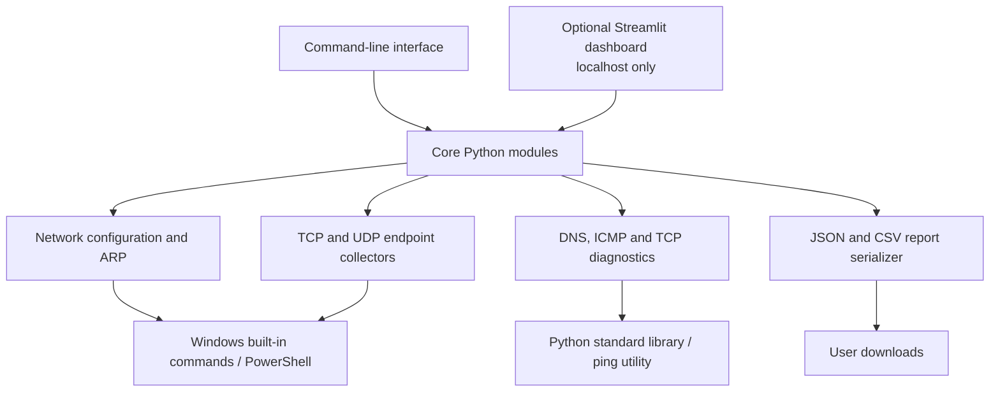

# SENTINEL X Architecture (v1.1.0)

SENTINEL X is a local Windows learning and diagnostics application. It is intentionally a small modular monolith: the CLI and optional dashboard reuse the same collection and validation modules.

## Component view

## Module responsibilities

| Module | Responsibility |
|---|---|
| `sentinel_x/cli.py` | Interactive command-line menu and text output |
| `sentinel_x/network.py` | Windows interface configuration, ARP parsing and IPv4 subnet calculations |
| `sentinel_x/connections.py` | TCP/UDP endpoint collection, readable TCP states and process/service enrichment |
| `sentinel_x/diagnostics.py` | Input validation, DNS resolution, bounded ping and single-host TCP checks |
| `sentinel_x/windows.py` | Runs fixed, application-authored PowerShell scripts and parses JSON |
| `sentinel_x/reporting.py` | Creates local JSON/CSV snapshots |
| `dashboard.py` | Optional Streamlit user interface; binds to `127.0.0.1` by default |

## Data flow

1. The user chooses a local inventory view or enters one target for a diagnostic test.
2. Inputs are validated before network operations.
3. Windows inventory collectors execute fixed PowerShell scripts. User-entered data is not interpolated into PowerShell.
4. Collected records are normalized into Python dictionaries.
5. The CLI prints records or the dashboard presents tables and summary metrics.
6. The report module serializes the current snapshot when the user explicitly downloads a report.

## Safety boundaries and limitations

- No subnet/range scanning, device enumeration, credential collection or remote agent deployment is implemented.
- Diagnostics are limited to a single user-supplied hostname/IP and, for TCP, one port.
- TCP connection success does not establish application-layer or TLS health.
- A listening socket or UDP endpoint is not automatically suspicious.
- UDP endpoint inventory shows local bindings, not proof of active datagram traffic or remote peers.
- Process/service attribution may be unavailable due to permissions or process exit races.
- Reports can contain private IP addresses, MAC addresses, process names, computer names and executable paths. Review and redact before sharing.
- The dashboard is a local snapshot UI with a short cache, not a packet-capture engine or real-time SIEM.
